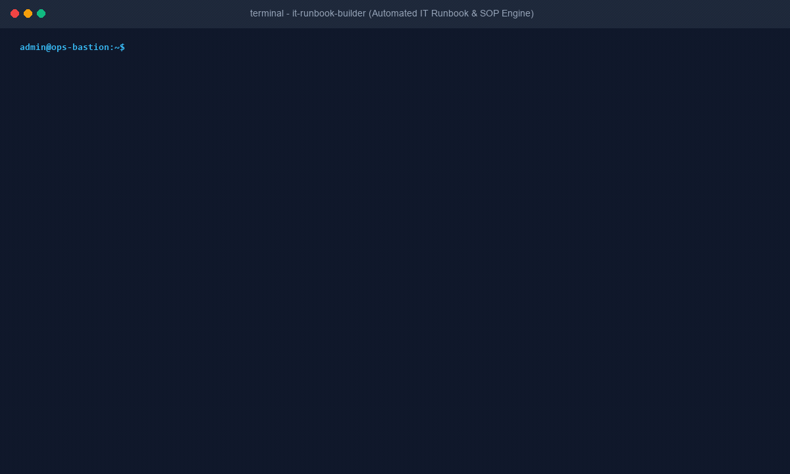

# IT Runbook & SOP Builder (`it-runbook-builder`)



[](tests/validate-skill.py)
[-blue.svg)](scripts/runbook_builder.py)
[](references/itil-runbook-standards.md)
[](LICENSE)

An enterprise documentation synthesis engine and agent skill that converts raw terminal command histories (Bash, Zsh, PowerShell), ITSM ticket work notes (ServiceNow, Jira), and incident bridge chat logs into standardized, audit-ready IT Runbooks and Standard Operating Procedures (SOPs). Features automated pre-flight assertions, parameter dictionary extraction, verification commands, and mandatory reverse-order rollback plans.

HD Video demonstration available in [`assets/demo.mp4`](assets/demo.mp4).

---

## Non-Technical Executive Overview

### The One-Sentence Pitch
A zero-dependency documentation engine that converts chaotic terminal histories and ad-hoc incident resolution notes into audit-ready, step-by-step IT Runbooks and SOPs with parameterized variables, verification commands, and explicit rollback plans.

### The Real-World Problem
Documentation debt plagues every IT engineering team, MSP, and DevOps organization:
1. **Tribal Knowledge & Unrecorded Outage Fixes:** When a Senior SysAdmin or SRE resolves a critical production issue at 2:00 AM, the solution remains trapped in their terminal scrollback, bash history, or a chaotic Slack thread. The next time the incident recurs, junior engineers spend hours reinventing the wheel.
2. **Missing Rollback & Verification Steps:** Informal internal documentation frequently lists commands without specifying pre-flight requirements, expected exit states, or what to do if step 3 fails midway, resulting in partial-state downtime and elevated change failure rates.
3. **Accidental Credential & Secret Leakage:** Engineers copying terminal sessions directly into public LLMs or internal wikis routinely leak hardcoded API tokens, private database IP addresses, internal Active Directory hostnames, and customer credentials.
4. **Maintenance Stagnation:** Standard Operating Procedures quickly become obsolete because authoring clean markdown documentation with standardized formatting is viewed as tedious administrative overhead.

### The 3-Step Walkthrough
1. **Input Raw Telemetry:** An engineer pipes or pastes a messy bash/PowerShell terminal session, a Jira ticket resolution work note, or an incident post-mortem transcript into the tool.
2. **Deterministic Extraction & Sanitization:** The offline engine (`scripts/runbook_builder.py`) scrubs hardcoded passwords, tokens, and internal IPs, identifies command sequences, parameterizes environment variables (e.g. replacing `prod-db01.corp.internal` with `<TARGET_HOST>`), and structures the workflow into pre-flight, execution, verification, and rollback tiers.
3. **Publish Standardized Runbook:** The tool outputs an audit-ready IT Runbook in GitHub-Flavored Markdown, Confluence/Jira wiki format, clean HTML, or structured JSON.

### Why IT Leadership Approves
- **100% Read-Only & Offline:** Operates entirely locally on static text files. Never connects to production hosts or external APIs.
- **Client-Side Secret & PII Sanitization (Rule 4):** Automatically replaces sensitive tokens (`Authorization: Bearer`, passwords, private RFC 1918 IPs, internal FQDNs) with parameterized placeholders before text leaves the machine or touches an LLM.
- **Zero Third-Party Dependencies (Rule 3):** Built purely in standard library Python (`re`, `json`, `argparse`, `html`, `pathlib`). No `pip install` required, zero EDR friction, and zero supply-chain risk.
- **Enforces ITIL / ISO 27001 / SOC 2 Documentation Standards:** Guarantees that every generated procedure contains mandatory ownership metadata, access prerequisites, step-by-step verification commands, and a verified backout/rollback plan.

---

## 8 Mandatory Runbook Sections Generated

| Section # | Section Name | Governance & Compliance Function |
| :--- | :--- | :--- |
| **Section 1** | Document Metadata & Scope | Establishes procedure ownership, review cadences, target systems, and estimated execution duration. |
| **Section 2** | Parameter & Variable Dictionary | Defines all environment variables (`<TARGET_FQDN>`, `<TARGET_IP>`, `<PORT>`) for staging/production portability. |
| **Section 3** | Prerequisites & Access Requirements | Details required administrative RBAC roles, installed tools, and firewall network paths. |
| **Section 4** | Pre-Flight Health Checks | Read-only state assertions (`df -h`, `systemctl status`, `dig`) to verify baseline health before mutating state. |
| **Section 5** | Step-by-Step Execution Procedure | Sequenced copy-paste commands paired with expected return codes and outputs. |
| **Section 6** | Post-Execution Verification | Explicit validation checks (`curl -I`, `Get-Service`, `openssl`) to prove operational success. |
| **Section 7** | Rollback & Backout Plan | Exact reverse-chronological recovery steps if any verification check fails. |
| **Section 8** | Troubleshooting & Common Failures | Matrix of known symptoms, potential root causes, and verified remediations. |

---

## Installation & Prerequisites

### Prerequisites
- Python 3.8 or higher.
- Standard operating system: Linux, macOS, or Windows PowerShell.
- Zero external Python package dependencies (no `pip install` required).

### Installation via Git
```bash
git clone https://github.com/ToritsejuBoyo/it-runbook-builder.git
cd it-runbook-builder
```

### Usage Examples
```bash
# Convert Bash / Linux command history to standard Markdown Runbook
python scripts/runbook_builder.py \
  --input tests/fixtures/fixture-bash-ssl-renewal.txt \
  --title "Standard Operating Procedure: Production Nginx SSL Renewal" \
  --environment "Production Linux" \
  --format markdown \
  --sanitize \
  --output runbook-ssl-renewal.md

# Convert PowerShell transcript to Atlassian Confluence wiki markup
python scripts/runbook_builder.py \
  --input tests/fixtures/fixture-powershell-iis-recycle.txt \
  --title "SOP: IIS Application Pool Remediation" \
  --environment "Windows Server 2022" \
  --format confluence \
  --sanitize \
  --output iis-runbook-confluence.txt

# Ingest Jira/ServiceNow ticket JSON and generate standalone responsive HTML
python scripts/runbook_builder.py \
  --input tests/fixtures/fixture-jira-ticket-dns-cutover.json \
  --format html \
  --sanitize \
  --output runbook-report.html

# Generate a sanitized SRE Portfolio Case Study (Proof-of-Work)
python scripts/runbook_builder.py \
  --input tests/fixtures/fixture-bash-ssl-renewal.txt \
  --generate-proof-of-work \
  --sanitize \
  --output case-study.md
```

---

## Agent Platform Setup & Integration

### Google Antigravity / AgentSkills.io
Clone or copy this repository into your agent's skills directory:
```bash
git clone https://github.com/ToritsejuBoyo/it-runbook-builder.git ~/.gemini/skills/it-runbook-builder
```

### Cursor / Claude Code
Reference `SKILL.md` directly in your workspace configuration or `.cursorrules`:
```markdown
When generating IT runbooks, SOPs, or documenting incident resolutions from terminal histories or ticket notes, activate and adhere to:
skills/it-runbook-builder/SKILL.md
```

---

## Hands-On Local Verification & Automated Test Harness

The repository includes a comprehensive 3-tier test harness with 100% synthetic mock datasets:

```bash
# 1. Standard Validation Suite (9 tests)
python tests/validate-skill.py

# 2. High-Volume Scale Benchmark (5,000 commands)
python tests/stress_test_runbook_builder.py

# 3. Extreme Malformed Payloads & Security Defense (8 tests)
python tests/extreme_test_runbook_builder.py
```

### Benchmark Results
- **Standard Harness:** 9/9 passed in 0.06s.
- **Scale Stress Test:** 5,000 commands ingested and synthesized into full SOP in 0.12s (40,204 cmds/sec throughput).
- **Extreme Payloads:** 8/8 passed (ReDoS resilience, zero-width Unicode injection, malformed ticket JSON, empty inputs).

---

## Repository Structure

```
it-runbook-builder/
├── .gitignore
├── LICENSE
├── README.md
├── SKILL.md
├── assets/
│   ├── demo.gif
│   ├── demo.mp4
│   ├── enterprise-runbook-template.md
│   └── proof-of-work-case-study-template.md
├── build-tools/
│   ├── generate-fixtures.py
│   └── generate-demo-media.py
├── references/
│   ├── itil-runbook-standards.md
│   └── runbook-standard-rubric.md
├── scripts/
│   ├── runbook_builder.py
│   └── sanitize_session_history.py
└── tests/
    ├── extreme_test_runbook_builder.py
    ├── stress_test_runbook_builder.py
    ├── validate-skill.py
    └── fixtures/
        ├── fixture-bash-ssl-renewal.txt
        ├── fixture-jira-ticket-dns-cutover.json
        ├── fixture-messy-incident-chat.txt
        └── fixture-powershell-iis-recycle.txt
```

---

## License

MIT License. Copyright (c) 2026 Toritseju Boyo.
See [`LICENSE`](LICENSE) for complete terms.
